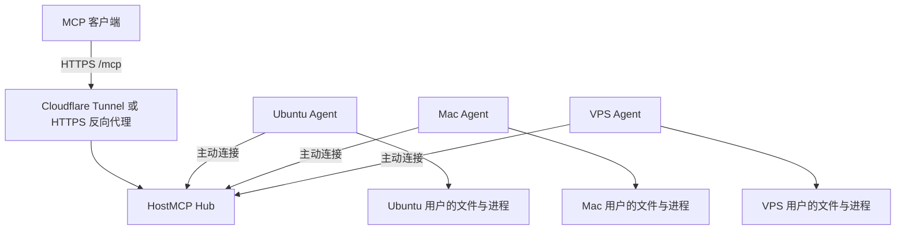

# HostMCP

**一个 MCP 入口，连接你自己的 Linux 和 Mac。**

HostMCP 将多台设备的原生文件、Shell 和进程能力提供给 MCP 客户端。Hub 可以放在
VPS，也可以放在家庭 Ubuntu 或 Mac 上；每台设备主动连入 Hub。家庭网络没有公网
IP 时，可用 Cloudflare Tunnel 发布 Hub。

运行时采用 Go 单一可执行文件，不依赖 Electron、浏览器扩展、Node.js 或模型 API。
设备 Agent 以启动它的系统用户身份执行操作，使用真实系统路径。它不会额外创建
逐目录批准流程，也不会自动获得 root 或绕过 macOS 隐私授权。

## 版本与范围

本分支正在交付 **0.1.0 运行时**。源码、发布流程和已完成的验证分别记录在
[验证记录](docs/validation.md)中；只有 GitHub Releases 中实际存在的资产才是
已发布版本。下文首先提供从源码构建的路径。

首版针对个人或单个信任域的自部署实例：静态 bearer 认证、Linux/macOS 原生
Agent、本地 stdio 和远程 Streamable HTTP。OAuth、多租户 SaaS、桌面键鼠控制、
截图和浏览器自动化不属于首版承诺。各客户端的实测状态见
[客户端接入](docs/clients.md)。

## 工作方式



Hub 负责认证、设备路由和 MCP 协议，不执行设备命令。要管理 Hub 所在机器，也
在该机器上运行一个独立 Agent。构建、测试和其他重任务发生在选定设备上；Hub
不需要运行大模型。低配机器的实际占用以[验证记录](docs/validation.md)为准。

## 从源码开始

需要 Go 1.25 或更新的兼容版本、Git；源码完整性检查需要 Python 3。

```sh
git clone https://github.com/soren-labs/hostmcp.git
cd hostmcp
python3 scripts/verify-source-import.py
go build -trimpath -o ./build/hostmcp ./cmd/hostmcp
./build/hostmcp version
```

将生成的可执行文件复制到每台设备，或分别从源码构建。可安装到用户目录：

```sh
mkdir -p "$HOME/.local/bin"
install -m 0755 ./build/hostmcp "$HOME/.local/bin/hostmcp"
export PATH="$HOME/.local/bin:$PATH"
```

有正式 Release 后，下载仓库中的安装脚本并指定确实存在的版本：

```sh
sh scripts/install.sh --version v0.1.0
```

脚本检测 Linux/macOS 与 amd64/arm64，校验 SHA-256，再安装到用户的
**~/.local/bin**。它不提权、不修改 sudoers，也不自动启动服务。未发布该版本时，
下载失败是预期行为；请使用源码构建。

### 1. 初始化 Hub

先确定对外地址，例如 **https://mcp.example.com**，再在 Hub 所在机器执行：

```sh
umask 077
mkdir -p "$HOME/.config/hostmcp"
chmod 700 "$HOME/.config/hostmcp"
hostmcp hub init \
  --config "$HOME/.config/hostmcp/hub.json" \
  --listen 127.0.0.1:8787 \
  --public-url https://mcp.example.com \
  --client-token-file "$HOME/.config/hostmcp/owner.token"
hostmcp hub serve --config "$HOME/.config/hostmcp/hub.json"
```

公开入口必须先指向该 Hub。选择[Cloudflare named Tunnel 或自有域名 HTTPS](docs/deployment.md)。
本机临时测试可使用 http://127.0.0.1:8787；公网部署使用 HTTPS。

### 2. 加入 Ubuntu、Mac 或其他 VPS

在 Hub 机器上为每台设备生成单独邀请：

```sh
hostmcp device invite \
  --config "$HOME/.config/hostmcp/hub.json" \
  --id ubuntu \
  --ttl 15m \
  --output ./ubuntu-invite.json
```

通过你控制的文件传输方式把邀请文件送到该设备。在目标设备上，以希望 Agent
使用的用户身份执行：

```sh
umask 077
mkdir -p "$HOME/.config/hostmcp"
hostmcp agent enroll \
  --invite ./ubuntu-invite.json \
  --config "$HOME/.config/hostmcp/agent.json"
hostmcp agent run --config "$HOME/.config/hostmcp/agent.json"
```

邀请包含临时加入凭证，使用后删除本次邀请副本。为 Mac 重复这一过程，并将
设备 ID 改为 **mac**。设备只需访问 Hub，不要求开放入站端口。

### 3. 验证并接入客户端

```sh
hostmcp call \
  --url https://mcp.example.com/mcp \
  --token-file "$HOME/.config/hostmcp/owner.token" \
  --tool list_devices --args '{}'
```

支持 HTTP Authorization header 的 MCP 客户端可以直接连接。支持本地 stdio
的客户端也可以通过桥接命令访问远程 Hub：

```sh
hostmcp connect \
  --url https://mcp.example.com/mcp \
  --token-file "$HOME/.config/hostmcp/owner.token"
```

单机使用不需要 Hub：把 **hostmcp stdio** 配为客户端的本地 MCP 命令即可。
完整 JSON 配置、认证边界和兼容性说明见[客户端接入](docs/clients.md)。

### 4. 作为用户服务运行

```sh
hostmcp service install --role hub \
  --config "$HOME/.config/hostmcp/hub.json" --name hostmcp-hub
```

在各设备上使用 **--role agent** 和对应的 **agent.json**。Linux 使用用户级
systemd，Mac 使用 LaunchAgent；登录/注销及开机行为见[部署文档](docs/deployment.md)。
**hostmcp doctor** 用于查看当前系统和运行身份。

## 文档

| 文档 | 内容 |
| --- | --- |
| [架构](docs/architecture.md) | Hub/Agent 边界、Go 选型、权限与连接模型 |
| [部署](docs/deployment.md) | 原生、Docker Hub、Cloudflare、自有域名、用户服务、卸载 |
| [客户端](docs/clients.md) | 直连、stdio 桥、本地模式、兼容性范围 |
| [安全模型](docs/security.md) | 认证、设备撤销、系统权限、信任边界 |
| [验证记录](docs/validation.md) | 已执行证据、待执行项、资源测量与限制 |
| [参与开发](CONTRIBUTING.md) | 构建、测试、发布与上游快照约束 |

## 源码来源

最初提交保存了 Chat On Steroids v2.1.11 的 62 个参考文件，并未包含可运行的独立
MCP 服务。**reference/** 保持原字节，**provenance/upstream.json** 记录哈希；
新 Go 运行时独立实现，不把该快照当作已完成的移植。历史
[提取计划](docs/extraction-plan.md)保留当时的 Node/TypeScript 候选设计；当前决策
见[架构文档](docs/architecture.md)。

保留上游 MIT 和 Codex 派生部分 Apache-2.0 声明，详见 **LICENSE**、**NOTICE**
及 **reference/chat-on-steroids/docs/licenses/codex/**。不读取、修改或接管正在
运行的 Chat On Steroids 安装与用户数据。

## English

HostMCP is a self-hosted MCP gateway for your Linux and macOS machines. A small Go
Hub routes authenticated MCP requests to native device Agents connecting outward.
Agents run as the OS account that starts them, with real filesystem paths and normal
OS permissions. Deploy the Hub on a VPS or publish a home machine through a named
Cloudflare Tunnel. No public IP is required on a device.

Version 0.1.0 targets single-owner deployments, static bearer authentication, local
stdio and remote Streamable HTTP. It does not promise OAuth, desktop automation,
automatic privilege elevation, or compatibility with every MCP client. See the
[validation record](docs/validation.md) for evidence and remaining limitations.
