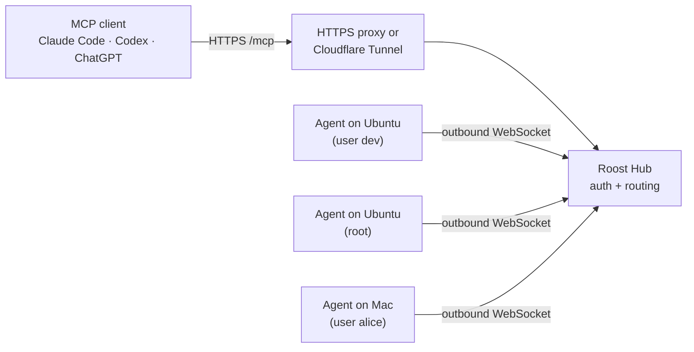

# Roost

[](https://github.com/soren-labs/roost/actions/workflows/ci.yml)
[](https://github.com/soren-labs/roost/releases/latest)
[](go.mod)
[](LICENSE)

**Give any AI client a shell on your own machines — from the browser, your phone or the terminal.**

[简体中文](README.zh-CN.md)

Roost is a self-hosted [Model Context Protocol](https://modelcontextprotocol.io/)
gateway. Add one URL as a connector and AI clients such as Claude, ChatGPT,
Codex and Claude Code can run commands and edit files on every Linux and macOS
machine you enroll: your laptop, a home server, a fleet of VPSes.

It is built for the case local MCP servers cannot cover. A chat in a web or
mobile app cannot launch a process on your computer, and SSH-based MCP servers
need a reachable port on every target. With Roost, each machine runs a small
**Agent** that connects *out* to your **Hub** — the machines come home to roost
— so nothing needs a public IP or an open inbound port. The Hub authenticates
clients and routes each tool call to the machine you pick.

Each Agent acts as the OS account that runs it: real paths, your shell and
environment, normal Unix permissions. No containers, no directory allowlists,
no Node.js or Electron on the devices.

> Roost was called **HostMCP** up to v0.2.4. Existing installations keep
> working; see [Migrating from HostMCP](docs/migrating-from-hostmcp.md).

## Features

- **Multi-device**: one Hub, many machines. Put the Hub on a VPS, or on a home
  machine published through Cloudflare Tunnel.
- **Per-account nodes**: a node is one machine plus one OS account. Run
  `build-box-worker` and `build-box-root` side by side and grant each AI client
  only the nodes it needs.
- **Native tools**: shell commands with PTY support, managed long-running
  processes, file read/write, Codex-style `apply_patch`, and image viewing.
- **Standard MCP**: Streamable HTTP for remote clients, stdio for local use, and a
  stdio bridge (`roost connect`) for clients that only launch local commands.
  Built on the official MCP Go SDK.
- **Client authentication**: per-client bearer tokens, an external OAuth 2.1
  resource server, or Cloudflare Access Managed OAuth assertions.
- **Small footprint**: a single static binary for Linux and macOS (amd64, arm64).
  The Hub measured 12–16 MiB RSS on a 412 MiB VPS with three devices connected
  ([measurement](docs/validation/README.md)).
- **Service install**: generates systemd and launchd user or system services.

## How it works



The Hub never runs commands itself. To manage the Hub machine, run an Agent there
too. Builds and other heavy work happen on the device you pick.

## Tools

| Tool | What it does |
| --- | --- |
| `list_devices` | Nodes visible to this client, with online state, OS user and UID (remote Hub only) |
| `device_info` | OS account, UID/GID, groups, working directory and shell of a node |
| `exec_command` | Run a shell command, optionally in a PTY; returns a session for long-running work |
| `write_stdin` | Read more output from a session, send input or signals, resize a PTY |
| `list_processes` / `terminate_process` | List and stop the caller's own sessions |
| `read` | Read files (text line ranges or base64), list directories, show metadata |
| `write_file` | Create or overwrite a file (text or base64) |
| `apply_patch` | Apply a `*** Begin Patch` add/update/delete/move patch |
| `view_image` | Return a PNG, JPEG or GIF file as MCP image content |

On a remote Hub every device tool takes a `device` argument with the node ID from
`list_devices`. In local `stdio` mode the tools act on the current machine.

For non-PTY `exec_command`, `yield_time_ms` waits for the command to finish or for
that interval to elapse (default 1000 ms; zero returns immediately). PTYs and
`write_stdin` return when output is available; filling the output budget also
returns early. A still-running command keeps its session for later polling.
`timeout_seconds` controls the command's execution lifetime separately.

## Install

Pre-built binaries for Linux and macOS (amd64, arm64) are on the
[releases page](https://github.com/soren-labs/roost/releases). The installer
picks the right archive, verifies its SHA-256 and installs to `~/.local/bin`:

```sh
curl -fsSLo roost-install.sh \
  https://raw.githubusercontent.com/soren-labs/roost/v0.2.4/scripts/install.sh
sh roost-install.sh --version v0.2.4
export PATH="$HOME/.local/bin:$PATH"
roost version
```

Use `--role hub` or `--role agent` to install the smaller single-role binaries
(`roost-hub`, `roost-agent`). The default `roost` binary contains every command.

To build from source you need Go 1.25 or newer:

```sh
git clone https://github.com/soren-labs/roost.git
cd roost
make build            # writes ./build/roost
```

`go install github.com/soren-labs/roost/cmd/roost@latest` also works; such
builds report a `-dev` version because release metadata is not stamped in.

## Quick start: one machine

No Hub is needed. Point your MCP client at `roost stdio`; tools run as the user
who starts the client.

```sh
# Claude Code
claude mcp add --transport stdio roost -- "$HOME/.local/bin/roost" stdio
# Codex CLI
codex mcp add roost -- "$HOME/.local/bin/roost" stdio
```

Clients that use an `mcpServers` JSON file:

```json
{
  "mcpServers": {
    "roost": { "command": "/absolute/path/to/roost", "args": ["stdio"] }
  }
}
```

## Quick start: several machines

The example uses `https://mcp.example.com` as the Hub's public HTTPS address. See
[deployment](docs/deployment.md) for Cloudflare Tunnel, Caddy and Docker setups.

**1. Create and start the Hub** (on the Hub machine):

```sh
roost hub init --public-url https://mcp.example.com \
  --client-token-file ~/.config/roost/owner.token
roost hub serve           # listens on 127.0.0.1:8787; put HTTPS in front of it
```

**2. Invite a device** (on the Hub machine). `--user` binds the node to the OS
account it must run as:

```sh
roost device invite --id laptop --user alice --output laptop-invite.json
```

**3. Enroll and run the Agent** (on the device, as that user). Copy the invite
file over a channel you trust; it is single-use and expires after 15 minutes:

```sh
roost agent enroll --invite laptop-invite.json
roost agent run
```

**4. Connect a client.** Give each AI client its own token, scoped to the nodes it
needs:

```sh
# on the Hub machine
roost token create --id claude --devices laptop --output claude.token
```

```sh
# on the client machine, with claude.token copied there (chmod 600)
claude mcp add --transport stdio roost -- \
  "$HOME/.local/bin/roost" connect \
  --url https://mcp.example.com/mcp --token-file /absolute/path/claude.token
```

Clients that support remote MCP with an `Authorization` header can use
`https://mcp.example.com/mcp` directly. Check the setup from a shell:

```sh
roost call --url https://mcp.example.com/mcp \
  --token-file /absolute/path/claude.token --tool list_devices
```

**5. Keep it running.** Install the Hub and each Agent as a service:

```sh
roost service install --role hub   --config ~/.config/roost/hub.json   --name roost-hub
roost service install --role agent --config ~/.config/roost/agent.json --name roost-agent
```

User services are the default. For boot-time system services, root nodes and
several accounts on one machine, see [account nodes](docs/account-nodes.md).

## Security model

- **A token grants the full authority of the OS accounts behind its nodes.** An
  authorized client can run anything and read or write anything that account can.
  There is no directory or command allowlist by design. Give each client only the
  nodes it needs, and use dedicated low-privilege accounts where that matters.
- **Root is opt-in.** Agents never elevate. A root node is a separate Agent that an
  administrator deliberately runs as root.
- **Separate credentials** for clients, device invitations and device connections.
  The Hub stores only SHA-256 hashes. Tokens can be scoped, rotated and revoked
  without touching other clients or devices.
- **The Hub only routes.** It authenticates, checks the client's node grants and
  forwards the call. It has no command executor.
- **OS protections still apply**: file permissions, sudo policy, SELinux/AppArmor,
  and macOS TCC/SIP.

Read the full [security model](docs/security.md) before exposing a Hub to the
internet. Report vulnerabilities privately as described in [SECURITY.md](SECURITY.md).

## Status and limitations

The latest release is [v0.2.4](https://github.com/soren-labs/roost/releases/latest).
Roost is pre-1.0: it serves one owner or one trust domain, and minor versions
may change behavior. Each [validation record](docs/validation/README.md) lists
exactly what was tested, on which machines and with which clients.

Not supported today:

- Windows, desktop control (mouse, keyboard, screenshots) and browser automation;
- multi-tenant isolation between untrusted users of one Hub;
- a built-in identity provider. OAuth uses your own provider or Cloudflare Access;
- resuming process sessions after an Agent restart. Sessions survive network
  reconnects, but not Agent restarts.

## Documentation

| Topic | Document | Language |
| --- | --- | --- |
| Architecture and design decisions | [docs/architecture.md](docs/architecture.md) | 中文 |
| Deployment: Cloudflare Tunnel, Caddy, Docker, services | [docs/deployment.md](docs/deployment.md) | 中文 |
| Client setup: Claude Code, Codex, stdio bridge | [docs/clients.md](docs/clients.md) | 中文 |
| Account nodes: ordinary user and root on one machine | [docs/account-nodes.md](docs/account-nodes.md) | 中文 |
| Security model | [docs/security.md](docs/security.md) | 中文 |
| External OAuth | [docs/oauth.md](docs/oauth.md) | English |
| Cloudflare Access Managed OAuth | [docs/cloudflare-access.md](docs/cloudflare-access.md) | English |
| Hub/Agent components, compatibility and updates | [docs/components-updates.md](docs/components-updates.md) | English |
| Validation records | [docs/validation/](docs/validation/README.md) | 中文 / English |

Translations of the Chinese documents are welcome.

## Contributing

Bug reports, documentation fixes and pull requests are welcome. Start with
[CONTRIBUTING.md](CONTRIBUTING.md); `make check` runs the same checks as CI.
Participation is covered by the [code of conduct](CODE_OF_CONDUCT.md).

## License

Roost is released under the [MIT License](LICENSE). Release archives and the
container image include the license notices of the Go modules they are built from.
