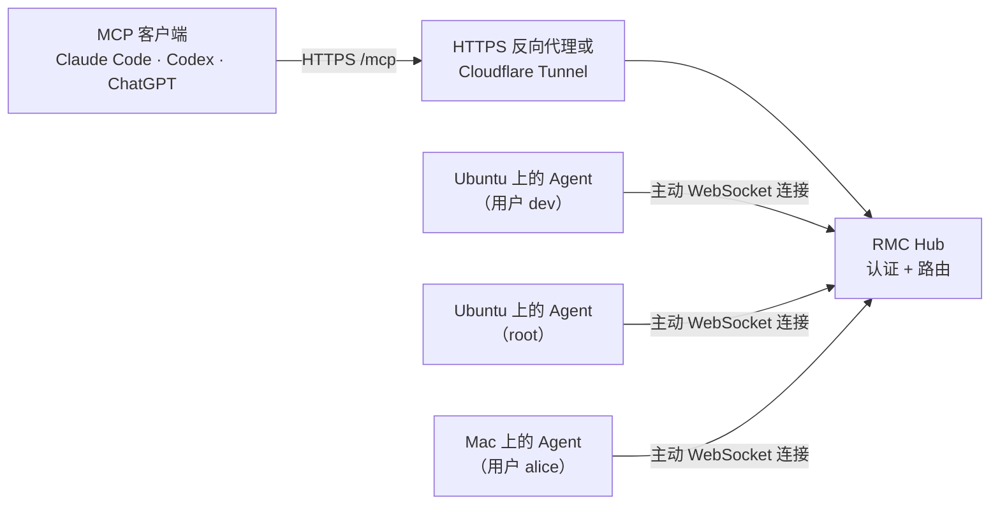

# RMC — Remote Machine Control

[](https://github.com/soren-labs/rmc/actions/workflows/ci.yml)
[](https://github.com/soren-labs/rmc/releases/latest)
[](go.mod)
[](LICENSE)

**让任何 AI 客户端操作你自己的机器——在浏览器、手机或终端里都行。**

[English](README.md)

RMC（Remote Machine Control，远程机器控制）是一个自托管的 [Model Context Protocol](https://modelcontextprotocol.io/)
网关。把一个 URL 添加为连接器，Claude、ChatGPT、Codex、Claude Code 等 AI 客户端
就能在你登记的每台 Linux 和 Mac 上执行命令、编辑文件：笔记本、家里的服务器、
一批 VPS 都可以。

它解决的是本地 MCP 服务器覆盖不到的场景：网页或手机 App 里的对话没法在你的电脑上
启动进程，基于 SSH 的 MCP 服务器又要求每台目标机器都有可访问的端口。用 RMC 时，
每台机器运行一个很小的 **Agent**，主动连出到你的 **Hub**，所以任何机器都不需要
公网 IP，也不用开放入站端口。Hub 负责认证客户端，并把每次工具调用转发到你选定的机器。

> RMC 在 v0.2.4 及以前叫 **HostMCP**。已有部署可以继续使用，详见
> [从 HostMCP 迁移](docs/migrating-from-hostmcp.md)。

每个 Agent 以启动它的系统账户身份运行：使用真实路径、你的 Shell 和环境变量、
正常的 Unix 权限。设备上不需要容器、不设目录白名单，也不需要 Node.js 或 Electron。

## 特性

- **多设备**：一个 Hub 管理多台机器。Hub 可以放在 VPS 上，也可以放在家里的机器上，
  通过 Cloudflare Tunnel 对外发布。
- **按账户划分节点**：一个节点 = 一台机器上的一个系统账户。同一台机器可以同时注册
  `build-box-worker` 和 `build-box-root`，每个 AI 客户端只授权它需要的节点。
- **原生工具**：支持 PTY 的 Shell 命令、可托管的长任务、文件读写、Codex 风格的
  `apply_patch`、图片查看。
- **标准 MCP**：远程客户端用 Streamable HTTP，本机用 stdio；只能启动本地命令的
  客户端可以用 stdio 桥（`rmc connect`）。基于官方 MCP Go SDK。
- **客户端认证**：每个客户端独立的 bearer token、外部 OAuth 2.1 资源服务器，或
  Cloudflare Access Managed OAuth 断言。
- **占用小**：Linux 和 macOS（amd64、arm64）都是单个静态可执行文件。在 412 MiB 内存
  的 VPS 上连接三台设备时，Hub 实测 RSS 为 12–16 MiB（[测量记录](docs/validation/README.md)）。
- **服务安装**：自动生成 systemd 和 launchd 的用户服务或系统服务。

## 工作方式



Hub 自己从不执行命令。要管理 Hub 所在的机器，也在那台机器上运行一个 Agent。
编译等重任务都在你选定的设备上执行。

## 工具

| 工具 | 作用 |
| --- | --- |
| `list_devices` | 当前客户端可见的节点、在线状态、系统用户和 UID（仅远程 Hub） |
| `device_info` | 节点的系统账户、UID/GID、用户组、工作目录和 Shell |
| `exec_command` | 执行 Shell 命令，可选 PTY；长任务返回 session。可选 `output_mode`、`clean_ansi` |
| `write_stdin` | 读取 session 的后续输出，发送输入或信号，调整 PTY 尺寸。可选 `wait_for_exit`、`output_mode`、`clean_ansi` |
| `list_processes` / `terminate_process` | 列出、停止调用者自己的 session |
| `read` | 读文件（文本行范围或 base64）、列目录、查看元数据；普通文件同时返回 `sha256` |
| `search` | 按 `glob` 查找文件，或用 RE2 / 字面量 `pattern` 搜索内容；只读，跳过隐藏、二进制和大文件 |
| `write_file` | 创建或覆盖文件（文本或 base64）；可选 `expected_sha256`，仅在内容未变时覆盖 |
| `apply_patch` | 应用 `*** Begin Patch` 格式的新增/修改/删除/移动补丁 |
| `view_image` | 把 PNG、JPEG、GIF 文件作为 MCP 图片内容返回 |

连接远程 Hub 时，每个设备工具都需要 `device` 参数，取值为 `list_devices` 返回的
节点 ID。本地 `stdio` 模式直接作用于当前机器。

非 PTY 的 `exec_command` 会等待命令结束或达到 `yield_time_ms`（默认 1000 毫秒，
设为 0 立即返回）。PTY 和 `write_stdin` 在有可读输出时返回；输出达到本次返回
上限时也会提前返回。仍在运行的命令保留 session，可继续查询。
`timeout_seconds` 单独控制命令本身的执行时限。

## 安装

Linux 和 macOS（amd64、arm64）的预编译版本在
[Releases 页面](https://github.com/soren-labs/rmc/releases)。安装脚本会选择
对应的归档、校验 SHA-256，并安装到 `~/.local/bin`：

RMC 的发布从 v0.3.0 开始。v0.2.4 及以前以 HostMCP 名义发布，安装的是 `hostmcp`
可执行文件，详见[从 HostMCP 迁移](docs/migrating-from-hostmcp.md)。

```sh
curl -fsSLo rmc-install.sh \
  https://raw.githubusercontent.com/soren-labs/rmc/v0.3.0/scripts/install.sh
sh rmc-install.sh --version v0.3.0
export PATH="$HOME/.local/bin:$PATH"
rmc version
```

加 `--role hub` 或 `--role agent` 可以安装更小的单角色版本（`rmc-hub`、
`rmc-agent`）。默认的 `rmc` 包含全部命令。

从源码构建需要 Go 1.25 或更新版本：

```sh
git clone https://github.com/soren-labs/rmc.git
cd rmc
make build            # 生成 ./build/rmc
```

也可以用 `go install github.com/soren-labs/rmc/cmd/rmc@latest`。这种方式
没有注入发布信息，版本号会显示为 `-dev`。

## 快速开始：单台机器

不需要 Hub。把 MCP 客户端指向 `rmc stdio` 即可，工具以启动客户端的用户身份运行。

```sh
# Claude Code
claude mcp add --transport stdio rmc -- "$HOME/.local/bin/rmc" stdio
# Codex CLI
codex mcp add rmc -- "$HOME/.local/bin/rmc" stdio
```

使用 `mcpServers` JSON 配置的客户端：

```json
{
  "mcpServers": {
    "rmc": { "command": "/absolute/path/to/rmc", "args": ["stdio"] }
  }
}
```

## 快速开始：多台机器

下面用 `https://mcp.example.com` 作为 Hub 的公网 HTTPS 地址。Cloudflare Tunnel、
Caddy、Docker 等部署方式见[部署文档](docs/deployment.md)。

**1. 创建并启动 Hub**（在 Hub 机器上）：

```sh
rmc hub init --public-url https://mcp.example.com \
  --client-token-file ~/.config/rmc/owner.token
rmc hub serve           # 监听 127.0.0.1:8787，前面需要配 HTTPS
```

**2. 邀请设备**（在 Hub 机器上）。`--user` 把节点绑定到它必须使用的系统账户：

```sh
rmc device invite --id laptop --user alice --output laptop-invite.json
```

**3. 在设备上加入并运行 Agent**（用对应的用户执行）。通过你信任的方式把邀请文件
传过去；邀请只能使用一次，15 分钟后过期：

```sh
rmc agent enroll --invite laptop-invite.json
rmc agent run
```

不想保存邀请文件时，可以用管道直接传给设备端（`--output -` 拒绝输出到终端）：

```sh
ssh hub-host rmc device invite --id laptop --user alice --output - | rmc agent enroll --invite -
```

**4. 接入客户端。** 每个 AI 客户端使用自己的 token，只授权它需要的节点：

```sh
# 在 Hub 机器上
rmc token create --id claude --devices laptop --output claude.token
```

```sh
# 在客户端机器上，claude.token 已复制过来（chmod 600）
claude mcp add --transport stdio rmc -- \
  "$HOME/.local/bin/rmc" connect \
  --url https://mcp.example.com/mcp --token-file /absolute/path/claude.token
```

支持远程 MCP 并能设置 `Authorization` header 的客户端，可以直接连接
`https://mcp.example.com/mcp`。在命令行检查是否连通：

```sh
rmc call --url https://mcp.example.com/mcp \
  --token-file /absolute/path/claude.token --tool list_devices
```

**5. 常驻运行。** 把 Hub 和每个 Agent 安装成服务：

```sh
rmc service install --role hub   --config ~/.config/rmc/hub.json   --name rmc-hub
rmc service install --role agent --config ~/.config/rmc/agent.json --name rmc-agent
```

默认安装用户服务。开机启动的系统服务、root 节点、同一台机器多个账户的配置，见
[账户节点](docs/account-nodes.md)。

## 安全模型

- **token 授予其节点背后系统账户的全部权限。** 获得授权的客户端可以执行该账户能
  执行的任何命令，读写该账户能访问的任何文件。项目有意不提供目录或命令白名单。
  每个客户端只授权它需要的节点；需要限制权限时，使用专门的低权限账户。
- **root 需要显式选择。** Agent 从不提权。root 节点是管理员特意以 root 运行的
  另一个 Agent。
- **凭证相互独立**：客户端、设备邀请、设备连接各用各的凭证。Hub 只保存 SHA-256
  哈希。每个 token 可以单独限定范围、轮换和撤销，不影响其他客户端或设备。
- **Hub 只做路由。** 它负责认证、检查客户端的节点授权并转发调用，没有命令执行器。
- **系统保护依然有效**：文件权限、sudo 策略、SELinux/AppArmor、macOS TCC/SIP。

把 Hub 暴露到公网之前，请先阅读完整的[安全模型](docs/security.md)。漏洞请按
[SECURITY.md](SECURITY.md) 私下报告。

## 状态与限制

最新版本见 [Releases](https://github.com/soren-labs/rmc/releases/latest)。
RMC 尚未到 1.0：面向单个所有者或单个信任域，minor 版本之间可能有行为变化。
每份[验证记录](docs/validation/README.md)都写明了实际测试的内容、机器和客户端。

目前不支持：

- Windows、桌面控制（键鼠、截图）和浏览器自动化；
- 同一个 Hub 上互不信任的多租户隔离；
- 内置身份提供方。OAuth 需要使用你自己的 provider 或 Cloudflare Access；
- Agent 重启后恢复进程 session。网络重连后 session 仍在，但 Agent 重启会丢失。

## 文档

| 主题 | 文档 | 语言 |
| --- | --- | --- |
| 架构与设计决策 | [docs/architecture.md](docs/architecture.md) | 中文 |
| 部署：Cloudflare Tunnel、Caddy、Docker、服务 | [docs/deployment.md](docs/deployment.md) | 中文 |
| 客户端接入：Claude Code、Codex、stdio 桥 | [docs/clients.md](docs/clients.md) | 中文 |
| 账户节点：同一台机器上的普通用户与 root | [docs/account-nodes.md](docs/account-nodes.md) | 中文 |
| 安全模型 | [docs/security.md](docs/security.md) | 中文 |
| 外部 OAuth | [docs/oauth.md](docs/oauth.md) | English |
| Cloudflare Access Managed OAuth | [docs/cloudflare-access.md](docs/cloudflare-access.md) | English |
| Hub/Agent 组件、兼容性与更新 | [docs/components-updates.md](docs/components-updates.md) | English |
| 验证记录 | [docs/validation/](docs/validation/README.md) | 中文 / English |

## 参与开发

欢迎提交问题、改进文档和 Pull Request。请先阅读 [CONTRIBUTING.md](CONTRIBUTING.md)；
`make check` 会运行与 CI 相同的检查。参与项目需遵守[行为准则](CODE_OF_CONDUCT.md)。

## 许可证

RMC 以 [MIT License](LICENSE) 发布。发布归档和容器镜像附带了构建所用 Go 模块的
许可证声明。
